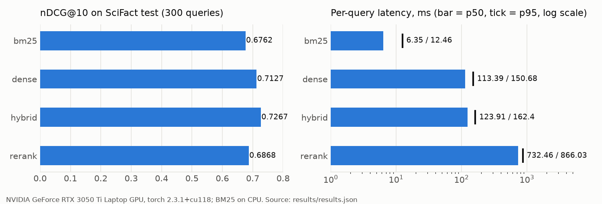
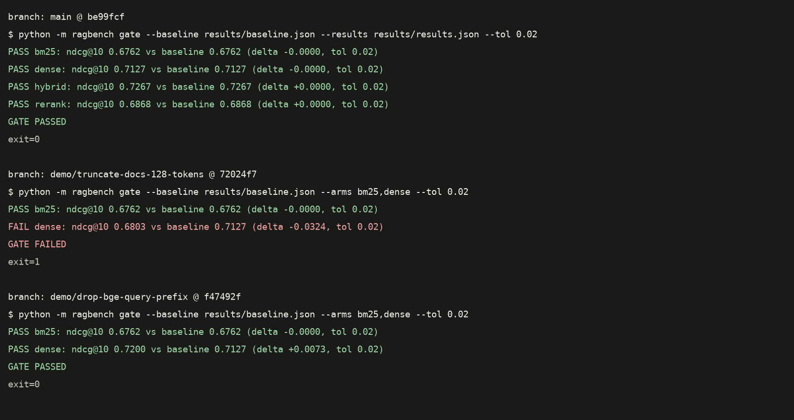

# rag-retrieval-eval-gate

**Measure, don't guess: BM25 vs dense vs hybrid (RRF) vs cross-encoder re-ranking on BEIR SciFact, with paired significance tests, per-query latency, a FastAPI search service and a CI gate that fails the build when retrieval quality regresses.**

 

<!-- The GitHub Actions badge is added once the repo is published and the workflow has run there. -->

## Overview

**Problem.** Most RAG demos pick a retriever (often "FAISS + some embedding model") and never measure it. Without a
golden set you cannot tell whether hybrid search or a re-ranker actually helps, what it costs in latency, or whether a
small code change (a missing query prefix, a new tokenizer) silently made retrieval worse.

**What this repo does.**

- Runs four retrieval arms over the same 5,183-document SciFact corpus: **BM25**, **dense** (bge-small-en-v1.5 + FAISS),
  **hybrid** (Reciprocal Rank Fusion of the two) and **re-rank** (cross-encoder over the hybrid top-100).
- Scores all of them on the 300 SciFact test queries with **nDCG@10, Recall@100 and MRR@10** (ranx), saves per-query
  scores, and tests every arm against BM25 with a **paired t-test and Fisher randomisation test**.
- Times each arm per query (p50 / p95) on this laptop's CPU and GPU.
- Dumps the 15 hardest queries for the best arm and categorises them by hand in [ERRORS.md](ERRORS.md).
- Exposes the arms as `GET /search` (FastAPI) and ships a **regression gate**: `python -m ragbench gate` exits non-zero
  when any arm's nDCG@10 falls more than 0.02 below the committed baseline. GitHub Actions runs it on every push/PR.

## Demo

`python -m ragbench run --arms bm25,dense,hybrid,rerank --split test` (full log: [results/run_test.log](results/run_test.log)):

```text
[data] 5183 docs, 300 test queries (0.6s)
[dense] index ready in 0.26s
[hybrid] RRF k tuned on train: {10: 0.760109873785094, 30: 0.7541049307648822, 60: 0.7515919782751525, 100: 0.7507788141738606} -> k=10
[rerank] 300 queries x 100 candidates in 194.1s
[bm25] ndcg@10=0.6762, recall@100=0.9127, mrr@10=0.6413, p50=6.35ms p95=12.46ms
[dense] ndcg@10=0.7127, recall@100=0.9417, mrr@10=0.6822, p50=113.39ms p95=150.68ms
[hybrid] ndcg@10=0.7267, recall@100=0.9650, mrr@10=0.6904, p50=123.91ms p95=162.4ms
[rerank] ndcg@10=0.6868, recall@100=0.9650, mrr@10=0.6575, p50=732.46ms p95=866.03ms
best arm: hybrid
```



The regression gate passing on `main`, failing on a deliberately broken branch (documents cut to 128 tokens), and
**not** failing when the bge query prefix is removed (on SciFact that change makes dense slightly better; see
[What the gate catches](#what-the-gate-catches-and-what-it-misses)). Rendered from the saved logs in `results/`:



`GET /search` response (from [results/api_latency.json](results/api_latency.json), `sample_response`):

```json
{
 "query": "0-dimensional biomaterials show inductive properties.",
 "arm": "hybrid",
 "k": 3,
 "results": [
  {
   "doc_id": "43385013",
   "title": "Epithelial and mesenchymal subpopulations within normal basal breast cell lines exhibit distinct stem cell/progenitor properties.",
   "score": 0.1218,
   "rank": 1
  },
  {
   "doc_id": "21456232",
   "title": "A graphene-based platform for induced pluripotent stem cells culture and differentiation.",
   "score": 0.0937,
   "rank": 2
  },
  {
   "doc_id": "34386619",
   "title": "The first gene of the Bacillus subtilis clpC operon, ctsR, encodes a negative regulator of its own operon and other class III heat shock genes.",
   "score": 0.0909,
   "rank": 3
  }
 ],
 "latency_ms": 95.706
}
```

## Architecture

```mermaid
flowchart LR
    HF[(HF Hub<br/>BeIR/scifact<br/>BeIR/scifact-qrels)] --> D[data.py<br/>title + text, cached]
    D --> B[bm25.py<br/>bm25s, k1=0.9 b=0.4<br/>stopwords + Snowball]
    D --> E[dense.py<br/>bge-small-en-v1.5 fp16<br/>FAISS IndexFlatIP<br/>.faiss + .npy cache]
    B -->|top-100| H[hybrid.py<br/>RRF, k tuned on TRAIN]
    E -->|top-100| H
    H -->|top-100| R[rerank.py<br/>ms-marco-MiniLM-L-6-v2]
    B & E & H & R --> EV[evaluate.py<br/>ranx nDCG@10 / R@100 / MRR@10<br/>t-test + Fisher vs BM25]
    B & E & H & R --> L[latency.py<br/>p50 / p95 per query]
    EV --> RES[(results/results.json<br/>results/table.md<br/>runs/&lt;arm&gt;.json)]
    L --> RES
    EV --> ER[errors.py<br/>15 hardest queries]
    RES --> G{gate.py<br/>nDCG@10 drop > 0.02<br/>vs baseline.json?}
    G -->|yes| F[exit 1: CI red]
    G -->|no| P[exit 0: CI green]
    B & E & H & R --> API[api.py<br/>FastAPI GET /search, /health]
```

## Tech stack

| Concern | Choice |
|---|---|
| Data | BEIR SciFact via Hugging Face Hub (pinned dataset revisions), pandas/pyarrow |
| Sparse retrieval | bm25s 0.3.13 (Lucene BM25 variant), PyStemmer (Snowball English) |
| Dense retrieval | sentence-transformers 5.7.0, BAAI/bge-small-en-v1.5, faiss-cpu 1.15.1 (`IndexFlatIP`) |
| Fusion | Reciprocal Rank Fusion (own implementation, about 10 lines) |
| Re-ranking | cross-encoder/ms-marco-MiniLM-L-6-v2 |
| Metrics and stats | ranx 0.3.21 (nDCG, Recall, MRR, paired t-test, Fisher randomisation) |
| Serving | FastAPI 0.143, uvicorn, pydantic v2; Docker (CPU torch, non-root) |
| Quality | pytest + pytest-cov, ruff, GitHub Actions |
| Runtime | Python 3.12, torch 2.3.1+cu118, NVIDIA RTX 3050 Ti Laptop GPU (4 GB) |

## Project structure

```text
rag-retrieval-eval-gate/
├── ragbench/
│   ├── __main__.py     # CLI: run | gate | baseline
│   ├── config.py       # constants, pinned HF revisions, paths, device
│   ├── data.py         # SciFact download + cache + size assertions
│   ├── bm25.py         # BM25 (bm25s, stopwords, Snowball stemmer)
│   ├── dense.py        # bge-small encoder + FAISS index, on-disk cache
│   ├── hybrid.py       # RRF + k tuning on train qrels
│   ├── rerank.py       # cross-encoder re-ranker
│   ├── evaluate.py     # ranx metrics, per-query scores, significance
│   ├── latency.py      # warm-up + per-query timing
│   ├── errors.py       # hardest-query dump
│   ├── pipeline.py     # end-to-end experiment -> results/
│   ├── search.py       # single-query search used by API and latency
│   ├── gate.py         # regression gate logic
│   └── api.py          # FastAPI app
├── tests/              # pytest (fixture corpus, fake encoder/scorer, no downloads)
├── scripts/
│   ├── bench_api.py          # HTTP latency through a real uvicorn server
│   ├── rerank_fp32_check.py  # ablation: re-ranker in fp32 instead of fp16
│   ├── fp32_dense_check.py   # ablation: bge-small in fp32 (the CI precision) vs the fp16 baseline
│   ├── profile_dense_query.py # raw forward pass vs full encode, to locate single-query latency
│   └── make_figures.py       # docs/*.png from results/
├── results/            # every number in this README comes from here
├── runs/               # per-query scores + top-10 per arm (test split)
├── docs/               # generated figures
├── ERRORS.md           # hand-categorised error analysis
├── .github/workflows/ci.yml
├── Dockerfile, .dockerignore
├── requirements.txt, requirements-dev.txt, pyproject.toml
└── CHANGELOG.md, LICENSE, github_meta.json
```

## Setup

Windows (what the results were produced on). The venv reuses the already-installed CUDA torch instead of downloading
another copy; nothing is installed into the system Python.

```powershell
python -m venv --system-site-packages .venv      # inherits torch 2.3.1+cu118 from the base interpreter
.venv\Scripts\python -m pip install -r requirements.txt -r requirements-dev.txt
```

Fresh machine (Linux/macOS/Windows, CPU):

```bash
python -m venv .venv && source .venv/bin/activate
pip install torch==2.3.1 --index-url https://download.pytorch.org/whl/cpu   # or the cu118 wheel for an NVIDIA GPU
pip install -r requirements.txt -r requirements-dev.txt
```

The first run downloads SciFact (about 4 MB of parquet/TSV into `data/`) and the two small models (into the Hugging Face
cache), then encodes the corpus once and caches it in `indexes/`.

## Usage

```bash
# Full experiment: 4 arms, test split -> results/results.json, results/table.md, runs/<arm>.json, results/errors*.{json,md}
python -m ragbench run --arms bm25,dense,hybrid,rerank --split test

# Freeze the current nDCG@10 per arm as the baseline (results/baseline.json is committed)
python -m ragbench baseline

# Regression gate: exit 1 if any arm drops more than 0.02 nDCG@10 below the baseline
python -m ragbench gate --baseline results/baseline.json --tol 0.02
python -m ragbench gate --baseline results/baseline.json --arms bm25,dense --results ci_results/results.json   # what CI runs

# API (indexes load once at startup; RAGBENCH_ARMS limits which arms are loaded)
uvicorn ragbench.api:app --port 8000
curl "http://localhost:8000/search?q=statins%20lower%20LDL%20cholesterol&arm=hybrid&k=5"
curl "http://localhost:8000/health"

# Docker (CPU; bm25, dense, hybrid by default)
docker build -t ragbench .
docker run -p 8000:8000 -v ragbench-cache:/home/app ragbench

# Tests and lint
pytest -q --cov=ragbench
ruff check .
```

`/search` validates its inputs: `q` must be non-empty and not only whitespace, `k` must be in [1, 100], `arm` must be one
of `bm25|dense|hybrid|rerank`; anything else returns **422**. An arm that was not loaded returns 503.

## Results

All numbers below come from `results/` and were produced on this machine on 2026-10-13:
Windows 10, AMD Ryzen 9 5900HX (8 cores), **NVIDIA GeForce RTX 3050 Ti Laptop GPU (4 GB)**, Python 3.12.10,
torch 2.3.1+cu118, sentence-transformers 5.7.0, faiss-cpu 1.15.1, bm25s 0.3.13, ranx 0.3.21. Dataset: **BEIR SciFact
test split, all 300 queries, full 5,183-doc corpus** (nothing subsampled). RRF k was tuned on the 809 train queries only.

### Retrieval quality and latency ([results/table.md](results/table.md))

| Arm | nDCG@10 | Recall@100 | MRR@10 | p vs BM25 (t-test / Fisher) | p50 ms | p95 ms | Device |
|---|---|---|---|---|---|---|---|
| BM25 | 0.6762 | 0.9127 | 0.6413 | baseline | 6.35 | 12.46 | CPU |
| Dense (bge-small) | 0.7127 | 0.9417 | 0.6822 | 0.031 / 0.031 * | 113.39 | 150.68 | GPU |
| **Hybrid (RRF, k=10)** | **0.7267** | **0.9650** | **0.6904** | 1.7e-06 / <1e-04 * | 123.91 | 162.40 | CPU + GPU |
| Re-rank (MiniLM CE, fp16) | 0.6868 | 0.9650 | 0.6575 | 0.49 / 0.50 | 732.46 | 866.03 | CPU + GPU |

`*` = significant at p < 0.05 (paired over the 300 queries; Fisher randomisation with 10,000 permutations, seed 42).
Latency = wall-clock of one `Searcher.search(q, arm, k=10)` call, batch size 1, measured over all 300 test queries after
10 untimed warm-up queries per arm. The arms are timed **interleaved** (for each query every arm runs once, in an order
that rotates per query), so load from other processes hits all arms equally. Re-rank latency is **5.9x hybrid at p50
and 5.3x at p95**.

**Through the API.** [scripts/bench_api.py](scripts/bench_api.py) starts a real uvicorn server, sends 10 warm-up
queries per arm and then all 300 test queries over HTTP (arms interleaved), and records the server-side `latency_ms`
and the client round-trip ([results/api_latency.json](results/api_latency.json)):

| Arm | server p50 ms | server p95 ms | round-trip p50 ms | round-trip p95 ms |
|---|---|---|---|---|
| bm25 | 5.61 | 10.38 | 12.64 | 22.51 |
| dense | 102.74 | 150.44 | 109.34 | 162.16 |
| hybrid | 106.67 | 159.33 | 113.95 | 170.08 |
| rerank | 669.56 | 832.19 | 677.64 | 841.18 |

**Why the GPU arms are slower than a bge-small forward pass should be.** During every latency run the 4 GB GPU was
also used by a local Ollama LLM server and another Python evaluation job. To check that the time is the GPU and not
ragbench code, [scripts/profile_dense_query.py](scripts/profile_dense_query.py) timed the raw Hugging Face forward
pass for one query against the full `BgeEncoder.encode` call ([results/dense_query_profile.log](results/dense_query_profile.log)):
p50 40.4 ms vs 49.5 ms. Most of the cost is the contended forward pass itself, so treat the GPU numbers as an upper
bound for this laptop, and compare arms by their ratios (all arms were timed in the same windows).

### Against the targets I set before running

| Target | Result | Met? |
|---|---|---|
| BM25 nDCG@10 within ±0.03 of the BEIR reference 0.665 | 0.6762 (+0.011) | yes |
| Dense bge-small nDCG@10 >= 0.70 (MTEB reports about 0.72) | 0.7127 | yes |
| Best arm beats BM25 by >= 5 nDCG@10 points, paired p < 0.05 | hybrid +5.05 points, p = 1.7e-06 (t), < 1e-04 (Fisher) | yes, narrowly |
| Hybrid Recall@100 >= 0.90 | 0.9650 | yes |
| p50/p95 per arm + re-rank multiplier vs hybrid | table above; 5.9x (p50), 5.3x (p95) | reported (below the 10-50x I expected; see the latency note) |
| CI gate green on main; broken change fails it | Gate passes on `main` ([results/gate_main.log](results/gate_main.log)); the 128-token truncation branch fails it, dense -0.032 ([log](results/gate_demo_truncate128/gate.log)). Dropping the query prefix does **not** fail it. Verified locally only: the repo is not on GitHub yet, so no Actions run exists | partly |
| Tests pass, >= 80% line coverage on `ragbench/` | ruff clean; 34 passed, 87.7% line coverage ([results/pytest.log](results/pytest.log)) | yes |
| `/search` p95 < 100 ms for the dense arm on GPU | server p95 150.4 ms, round-trip p95 162.2 ms, on a GPU shared with other jobs | **no** |

### Does hybrid or re-ranking beat dense alone? (honest answer)

- **Hybrid vs dense:** +0.014 nDCG@10 and +0.023 Recall@100, but the paired difference is **not significant**
  (t-test p = 0.19, Fisher p = 0.19). Hybrid is significantly better than BM25; against dense it is a small, unproven gain.
- **Re-rank vs dense:** the re-ranker is **worse** (0.6868 vs 0.7127; p = 0.078 / 0.076, not significant) and about 6x slower than
  hybrid. This matches the BEIR paper, where BM25 + the same family of MS MARCO cross-encoder reaches about 0.688 on
  SciFact: a re-ranker trained on short web queries does not transfer well to scientific claims.
  To rule out fp16 as the cause I re-ran the re-ranker in fp32 on the same GPU
  ([results/rerank_fp32/results.json](results/rerank_fp32/results.json)): nDCG@10 is 0.6868 again (to 4 decimals),
  so the drop comes from the model, not the precision.
- **What I would ship for SciFact-like data:** hybrid RRF. It is the best arm, costs about the same as dense alone (BM25
  adds about 6 ms p50 on CPU), and it raises Recall@100 to 0.965, which is what a downstream LLM reader needs.

### RRF k tuning (train split only, [results/rrf_tuning.json](results/rrf_tuning.json))

| k | 10 | 30 | 60 | 100 |
|---|---|---|---|---|
| train nDCG@10 (809 queries) | **0.7601** | 0.7541 | 0.7516 | 0.7508 |

k = 10 was frozen and used for the test numbers above. The test split was never used to choose k.

### What the gate catches and what it misses

I made three "plausible but harmful" changes on throwaway branches (`demo/*`, never merged), re-ran BM25 + dense on the
test split and ran the gate against the committed baseline (tolerance 0.02 nDCG@10):

| Branch | Change | bm25 delta | dense delta | Gate |
|---|---|---|---|---|
| `demo/truncate-docs-128-tokens` | `max_seq_length = 128` as a "speed-up" | 0.0000 | **-0.0324** | **FAILED** (exit 1) |
| `demo/drop-doc-titles` | index abstracts without titles | -0.0167 | -0.0159 | passed |
| `demo/drop-bge-query-prefix` | remove the bge query instruction | 0.0000 | **+0.0073** | passed |

Logs: `results/gate_demo_*/gate.log`. Two honest lessons:

- **Dropping the titles is a real regression the gate lets through**: both arms lose about 1.6 points, which is under
  the 0.02 tolerance. A tighter tolerance (or a per-query paired test against the baseline run) would catch it, at the
  cost of more false alarms from fp16/fp32 noise. 0.02 is a deliberate, stated trade-off, not a guarantee.
- **The query prefix does not help bge-small on SciFact.** I expected removing it to fail the gate; instead dense went
  *up* (0.7200 vs 0.7127 on test). The train split agrees (0.7524 without vs 0.7469 with,
  [results/prefix_ablation/](results/prefix_ablation/)). I kept the prefix because it is the model's documented
  usage and the difference is small, but on this dataset it is not the right "broken change" to demo a gate failure,
  so the truncation branch is used instead.

### Error analysis (details in [ERRORS.md](ERRORS.md))

The 15 lowest-nDCG@10 test queries for hybrid all score 0. By hand: **5 numeric/entity** (percentages, gene/miRNA
names, abbreviations), **4 multi-hop** (the gold abstract supports the claim only indirectly), **3 lexical mismatch**
("monocytes" vs "myeloid", "microenvironment" vs "milieu") and **3 label noise** (gold abstract on a different topic).
10 of the 15 gold documents are not in the hybrid top-100 at all, so first-stage recall, not ordering, is what limits
these queries; a re-ranker cannot recover them.

## How it works

Design decisions, in the order the data flows. Each one is a choice I can defend.

1. **Data (`data.py`).** SciFact is loaded from the Hugging Face Hub at **pinned dataset revisions** so the numbers are
   reproducible, cached in `data/`, and every document is indexed as `title + " " + text` (BEIR convention: titles carry
   a lot of signal on short scientific abstracts). The loader asserts 5,183 docs, 300 test queries and 809 train queries,
   so a silently changed dataset fails loudly instead of producing different numbers.
2. **BM25 (`bm25.py`).** `bm25s` with lowercasing, an English stopword list and the Snowball stemmer, `k1 = 0.9, b = 0.4`
   (Anserini's defaults, which the BEIR reference numbers use). Documents with score 0 share no query term and are
   dropped rather than returned as padding. bm25s was chosen over rank_bm25 because it precomputes a sparse score
   matrix at index time; a query costs a few ms (p50 6.35 ms measured here, on a busy CPU).
3. **Dense (`dense.py`).** bge-small-en-v1.5 (33M parameters, 384-d) is small enough for a 4 GB laptop GPU. bge-v1.5
   is trained with an **instruction prefix on queries only** ("Represent this sentence for searching relevant
   passages: "), so the prefix is added to queries and never to documents. Embeddings are L2-normalised, so inner
   product equals cosine, and `faiss.IndexFlatIP` gives **exact** search. With 5k vectors an approximate index (HNSW,
   IVF) would add recall loss and tuning for no speed benefit. On CUDA the model runs in fp16 (half the memory, faster);
   vectors are re-normalised in fp32 afterwards. The index and embeddings are saved as `.faiss` + `.npy`, keyed by
   model name, precision and a hash of the doc ids, so they are reused across runs and never mixed up.
4. **Hybrid (`hybrid.py`).** BM25 scores are unbounded and cosine scores live in [-1, 1], so adding raw scores needs
   normalisation choices that are easy to get wrong. **Reciprocal Rank Fusion** uses ranks only:
   `score(d) = sum over lists of 1 / (k + rank)`. A document missing from one list just gets no contribution from it.
   Ties are broken by doc id so runs are deterministic. `k` controls how much the top ranks dominate; it was grid-searched
   over {10, 30, 60, 100} **on the train qrels only** and frozen (k = 10) before touching test, to avoid tuning on the
   test set.
5. **Re-rank (`rerank.py`).** The cross-encoder reads query and document together, which is more accurate in principle
   but costs one transformer forward pass per candidate: 100 passes per query (batch 32, max_length 512, fp16). It
   re-scores the hybrid top-100, so Recall@100 is unchanged by construction and only the order moves.
6. **Evaluation (`evaluate.py`).** ranx computes nDCG@10 (graded ranking quality of the first page), Recall@100 (is the
   evidence in the candidate set a re-ranker or LLM would see) and MRR@10 (how soon the first relevant doc appears).
   Runs are passed to ranx with strictly decreasing position scores so ranx evaluates exactly the order we produced.
   Queries with no results score 0 instead of being skipped. Per-query scores go to `runs/<arm>.json`.
7. **Significance.** Every arm is compared with BM25 on the **same 300 queries**, so the tests are paired: Student's
   paired t-test and a Fisher randomisation (permutation) test, which makes no normality assumption. With 300 queries a
   1-2 point difference can easily be noise; that is exactly what the hybrid-vs-dense test shows.
8. **Latency (`latency.py`).** Batch size 1, because that is what an online request looks like. 10 warm-up queries
   first (CUDA kernels, caches), then every test query once; p50 and p95 because tail latency is what users notice.
9. **Gate (`gate.py`, CLI `gate`).** `results/baseline.json` stores the frozen nDCG@10 per arm. The gate fails if any
   gated arm is more than `tol` (0.02) below its baseline, or missing from the results. The tolerance absorbs harmless
   noise such as fp16 on GPU vs fp32 on the CPU CI runner, but catches real regressions.
10. **CI (`.github/workflows/ci.yml`).** ruff, then pytest with an 80% coverage floor, then a real BM25 + dense run on the
    SciFact test split on CPU and the gate. The Hugging Face cache, data and index are cached with `actions/cache`. The
    re-rank arm is **local-only** (100 cross-encoder passes x 300 queries is too slow on a free CPU runner).
11. **API (`api.py`).** Indexes and models load once in the FastAPI lifespan. Endpoints are plain `def`, not `async def`:
    the work is CPU/GPU-bound and blocking, so FastAPI runs it in its threadpool instead of freezing the event loop.
    pydantic validates `q`, `k` and `arm` and returns 422 on bad input.
12. **Tests (`tests/`).** They need no downloads and take one to three minutes, mostly numba JIT compilation inside ranx: a 5-doc fixture corpus, a hashed bag-of-words
    fake encoder and a word-overlap fake cross-encoder exercise the real BM25, FAISS, RRF, ranx, pipeline, API and gate
    code. The nDCG test checks ranx against a hand-computed value; the gate test checks a 0.03 drop fails and a 0.01 drop
    passes.

## Reproducing

- Seed 42 (Fisher randomisation). Retrieval itself is deterministic: exact FAISS search, deterministic BM25, RRF ties
  broken by doc id. Re-running gives identical nDCG/Recall/MRR and identical `runs/*.json`.
- Caveat: ranx runs the Fisher test in parallel numba threads, and the seed does not make that bit-reproducible. Across
  my runs the Fisher p-values moved by about 0.01 (e.g. dense vs BM25 0.029 in one run, 0.031 in the next). No
  significance conclusion changed. The t-test p-values are exact and stable.
- Latency is not reproducible to the millisecond on a shared laptop; treat the ratios between arms as the result.
- Versions: see `requirements.txt` and `results/results.json -> environment`. Dataset and model revisions are pinned in
  `ragbench/config.py`.
- GPU: RTX 3050 Ti Laptop (4 GB), CUDA 11.8 build of torch 2.3.1. fp16 on GPU and fp32 on CPU give slightly different
  dense scores; see the CPU check below.
- Steps: setup above, then `python -m ragbench run --arms bm25,dense,hybrid,rerank --split test`,
  `python scripts/bench_api.py --arms bm25,dense,hybrid,rerank`, `python scripts/make_figures.py`.

### CPU check (what CI would run)

The baseline comes from fp16 on the GPU; the CI job runs bge-small in fp32 on a CPU runner.

- **Precision.** I re-ran BM25 + dense with bge-small in fp32 ([scripts/fp32_dense_check.py](scripts/fp32_dense_check.py),
  run on the GPU because it is the same fp32 arithmetic as the CPU path and much faster). Dense nDCG@10 is 0.7127,
  identical to fp16 to four decimals, and the gate passes ([results/fp32_dense/](results/fp32_dense/),
  [results/gate_fp32_dense.log](results/gate_fp32_dense.log)).
- **A full CPU run was not completed on this laptop.** An earlier attempt crashed with a segmentation fault during
  corpus encoding (cause not diagnosed). A timed probe then encoded 128 documents in 147 s, 0.87 docs/s, while the CPU
  was shared with other jobs ([results/cpu_encode_probe.log](results/cpu_encode_probe.log)), which projects to about
  99 minutes for the whole corpus. That is why the CI job has a 180-minute timeout and caches `indexes/` with
  `actions/cache`. I have not seen how long it takes on a GitHub runner.

## Limitations and next steps

- **One dataset.** SciFact is small (5k docs, 300 test queries) and claim-style. FiQA (financial QA) was in the original
  plan and is the obvious next dataset; it is not included here.
- **Latency is from a shared laptop GPU.** During the runs the GPU was also used by a local Ollama LLM server and another
  Python evaluation job (see the process list in [results/dense_query_profile.log](results/dense_query_profile.log)),
  so the GPU numbers are noisy and pessimistic. A single process with batch size 1; this is not a load test.
- **The dense `/search` p95 < 100 ms target was not met** (server p95 150.4 ms on the shared GPU). I did not get
  a run with the GPU to myself, so I cannot say whether it would be met on an idle GPU.
- **CI has not run on GitHub yet** (the repo is not published). The workflow's steps were run locally on CPU (results
  above), not on an Actions runner.
- The Docker image was written but **not built on this machine** (Docker is not installed here).
- The re-ranker is a general MS MARCO model; a biomedical cross-encoder or a larger bge-reranker may change the
  re-rank conclusion. Fine-tuning on the SciFact train split is another option.
- Only binary relevance (SciFact qrels are all 1), so nDCG here does not exercise graded relevance.

## License and credits

Code: [MIT](LICENSE), Copyright (c) 2026 Shivansh Bhardwaj.

| Asset | Source | Licence |
|---|---|---|
| SciFact corpus/queries | [BeIR/scifact](https://huggingface.co/datasets/BeIR/scifact) (Wadden et al., 2020; BEIR, Thakur et al., 2021) | CC BY-SA 4.0 (per the HF card) |
| SciFact qrels | [BeIR/scifact-qrels](https://huggingface.co/datasets/BeIR/scifact-qrels) | CC BY-SA 4.0 (per the HF card) |
| Dense model | [BAAI/bge-small-en-v1.5](https://huggingface.co/BAAI/bge-small-en-v1.5) | MIT |
| Re-ranker | [cross-encoder/ms-marco-MiniLM-L-6-v2](https://huggingface.co/cross-encoder/ms-marco-MiniLM-L-6-v2) | Apache-2.0 |
| BM25 | [bm25s](https://github.com/xhluca/bm25s) | MIT |
| Metrics | [ranx](https://github.com/AmenRa/ranx) | MIT |
| Vector index | [FAISS](https://github.com/facebookresearch/faiss) | MIT |

The dataset is not redistributed in this repo; it is downloaded from the Hugging Face Hub at run time.
